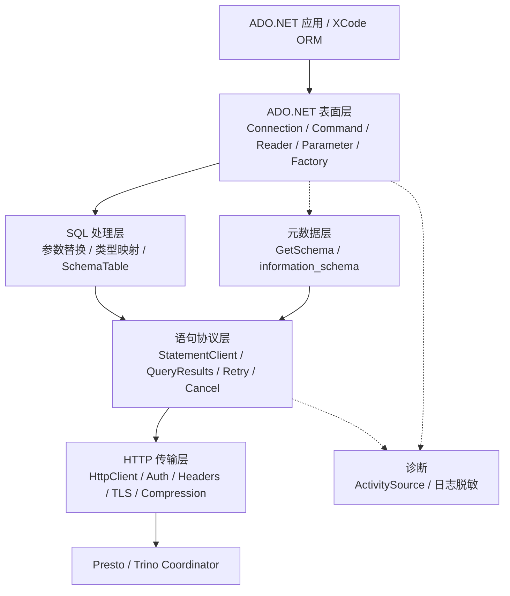
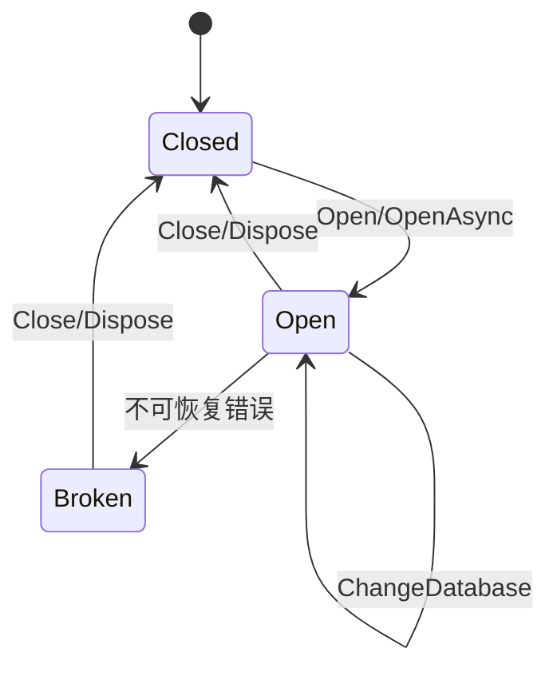
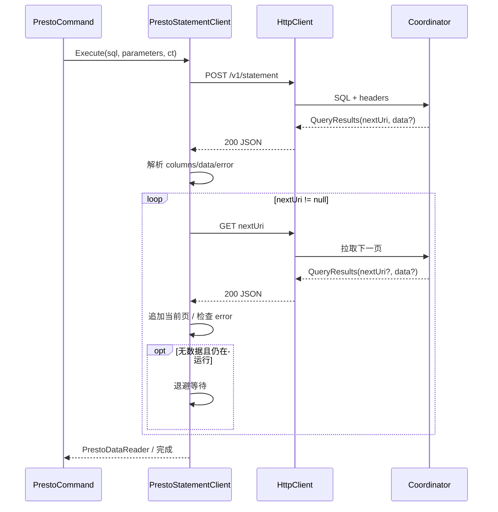
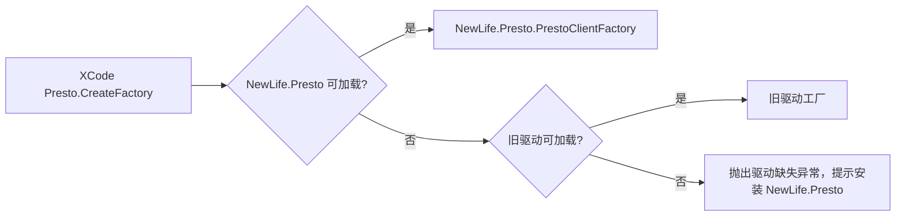

# NewLife.Presto 架构设计

> 版本：v1.0 | 日期：2026-11-20
> 需求对应：[需求文档](需求文档.md) | 功能清单：[功能清单](功能清单.md)

## 1. 整体架构

NewLife.Presto 是纯 C# 的 ADO.NET 驱动，协议层使用 Presto/Trino 官方 HTTP REST v1 客户端协议。整体分为四层，外加连接串、认证、诊断、脱敏等横切能力。



设计原则：

- **表面层薄**：ADO.NET 类型只做状态、参数与结果集适配，不承载协议细节。
- **协议层独立**：语句客户端可独立测试，不依赖 `DbConnection`；便于假 HTTP 处理器覆盖轮询、重试、取消。
- **零第三方依赖**：HTTP 用 BCL `HttpClient`，JSON 用 `NewLife.Core` 的 `JsonParser`，日志与基础工具用 `NewLife.Core`。
- **失败可解释**：服务端错误码、SQLState、查询 ID、HTTP 状态与重试过程保留在异常/日志中。
- **不为少见场景增加核心复杂度**：事务、DDL、批量、spooling、EF 等进入暂缓清单，通过扩展点或独立包承接。

## 2. SYS 系统基础

### 2.1 职责

| 职责 | 说明 |
|------|------|
| 连接串解析 | 参数、别名、默认值、合法性校验 |
| 连接生命周期 | Open/Close/Dispose/ChangeDatabase 状态机 |
| HTTP 传输 | 共享 HttpClient、代理、TLS、压缩、超时 |
| 认证 | Basic、JWT/Bearer、自定义头 |
| 会话上下文 | Catalog/Schema/User/TimeZone/SessionProperties |
| 诊断 | 日志、脱敏、ActivitySource |

### 2.2 核心组件

| 组件 | 文件 | 说明 |
|------|------|------|
| `PrestoConnectionStringBuilder` | `Common/PrestoConnectionStringBuilder.cs` | 继承 `DbConnectionStringBuilder`，提供强类型属性、别名归一化与校验 |
| `PrestoConnectionOptions` | `Common/PrestoConnectionOptions.cs` | 解析后的不可变配置：端点、认证、协议头、会话、超时、代理（待实现） |
| `PrestoConnection` | `PrestoConnection.cs` | `DbConnection` 实现；持有 options 与 `PrestoStatementClient`（待实现） |
| `PrestoHttpClientCache` | `Common/PrestoHttpClientCache.cs` | 按端点/TLS/代理缓存共享 `HttpClient`（待实现） |
| `PrestoAuthProvider` | `Common/PrestoAuthProvider.cs` | 生成 Authorization 头；Basic/JWT/自定义（待实现） |
| `PrestoHeaders` | `Common/PrestoHeaders.cs` | Presto/Trino 头前缀与请求/响应头名 |
| `PrestoTypeMapper` | `Common/PrestoTypeMapper.cs` | 类型签名解析与 .NET 类型映射 |
| `PrestoDiagnostics` | `Common/PrestoDiagnostics.cs` | `ActivitySource("NewLife.Presto")` 与日志脱敏（待实现） |
| `PrestoException` | `PrestoException.cs` | `DbException` 子类，携带查询 ID、错误码、SQLState |
| `PrestoDriver` | `PrestoException.cs` | 标题、描述与版本，元数据本地化入口 |

### 2.3 连接字符串模型

| 参数 | 别名 | 默认值 | 说明 |
|------|------|--------|------|
| `Host` | `Server` / `Data Source` / `DataSource` | `localhost` | 协调器主机 |
| `Port` | — | `8080` | 协调器端口；HTTPS 常用 443，需显式指定 |
| `Catalog` | `Database` / `Initial Catalog` | 空 | 默认 catalog；XCode 的 `Database` 映射到此 |
| `Schema` | `Owner` | 空 | 默认 schema；XCode 的 `Owner` 映射到此 |
| `User` | `User ID` / `Username` / `UID` | 环境用户 → `anonymous` | 请求头用户；不因缺省直接抛异常 |
| `Password` | `Pwd` | 空 | Basic 认证密码 |
| `UseSsl` | `EnableSSL` / `SSL` / `UseSSL` | `false` | 是否使用 HTTPS |
| `TrustServerCertificate` | `IgnoreSslErrors` | `false` | 放宽证书校验；开启时记录警告 |
| `Auth` | — | 有密码时 `Basic`，否则 `None` | `None` / `Basic` / `JWT` |
| `AccessToken` | `Token` | 空 | JWT/Bearer 令牌 |
| `Protocol` | `TrinoHeaders` | `Presto` | `Presto` / `Trino`；`TrinoHeaders=true` 等价于 `Trino` |
| `TimeZone` | — | `UTC` | `X-Presto-Time-Zone` / `X-Trino-Time-Zone` |
| `Language` | — | 空 | 请求头语言 |
| `Source` | `ApplicationName` | `NewLife.Presto` | 客户端来源标识 |
| `ClientTags` | — | 空 | 逗号分隔的客户端标签 |
| `ClientInfo` | — | 空 | 客户端信息 |
| `ResourceGroup` | — | 空 | 资源组 |
| `TraceToken` | — | 空 | 链路追踪令牌 |
| `SessionProperties` | — | 空 | `key=value` 以 `|` 分隔 |
| `CustomHeaders` | — | 空 | `name:value` 以 `|` 分隔；不得覆盖核心头 |
| `Path` | `BasePath` | 空 | 网关路径前缀，如 `/trino` |
| `Proxy` | `HttpProxy` | 空 | 代理 URL；为空时使用系统默认代理 |
| `CommandTimeout` | — | `0` | 命令超时秒数；0 表示不限制 |
| `ConnectionTimeout` | — | `100` | HTTP 请求超时秒数 |
| `TestConnection` | — | `false` | Open 时是否请求 `/v1/info` |
| `Compression` | — | `true` | 是否发送 Accept-Encoding 并自动解压 |
| `MaxRetries` | — | `3` | 瞬态错误最大重试次数 |
| `RetryInterval` | — | `200` | 初始退避毫秒数，指数增长 |

> `Pooling` 等传统 ADO 参数可解析但不生效：HTTP 连接复用由 `HttpClientHandler` 负责，驱动不维护物理连接池。

### 2.4 连接生命周期



- `Open`：解析连接串 → 取得/创建共享 `HttpClient` → 建立会话上下文；默认不发网络请求。
- `TestConnection=true`：`Open` 时请求 `/v1/info`，失败则回到 `Closed` 并抛出 `PrestoException`。
- `ChangeDatabase`：更新 Catalog；若参数形如 `catalog.schema`，同时更新 Schema；后续请求头生效。Presto 的 `USE` 语义因连接器而异，驱动不主动执行 SQL。
- `Close`：标记状态，尽力取消该连接下活跃的查询（best-effort DELETE），释放命令/读取器引用。
- 连接对象按 ADO.NET 约定**非线程安全**；共享 `HttpClient` 线程安全。

### 2.5 HTTP 传输与 HttpClient 缓存

- 缓存键：`scheme + host + port + path + proxy + TrustServerCertificate`；认证头按请求附加，不进入缓存键。
- `HttpClientHandler` 配置：`AutomaticDecompression = GZip | Deflate`（`Compression=true`）、`UseCookies=false`、`AllowAutoRedirect=true`、`Proxy`。
- `net45` 下显式启用 TLS 1.2：`ServicePointManager.SecurityProtocol |= SecurityProtocolType.Tls12`；更高框架使用系统默认。
- 请求头统一由 `PrestoHeaders` 生成；`User-Agent` 形如 `NewLife.Presto/1.0`。
- 响应体按流读取，避免一次性复制大字符串；`JsonParser` 负责将当前页解析为字典/列表模型。

### 2.6 认证

| 模式 | 请求头 | 说明 |
|------|--------|------|
| `None` | 无 Authorization | 集群未启用认证 |
| `Basic` | `Authorization: Basic base64(user:password)` | 预发送，避免 401 往返；密码为空时退化为无密码 |
| `JWT` | `Authorization: Bearer {token}` | 令牌不写日志；支持 `Func<String>` 刷新回调扩展点 |
| 自定义头 | `CustomHeaders` | 网关租户、追踪等；禁止覆盖 `Authorization` 与协议核心头 |

### 2.7 日志与脱敏

- 使用 `NewLife.Core` 的 `ILog`/`XTrace`；驱动内不直接写 Console。
- 默认日志字段：操作名、URI（去除查询串）、HTTP 状态、耗时、查询 ID、错误码。
- 默认脱敏：`Password`、`AccessToken`、`Authorization`、完整连接串；查询文本仅在 Debug 级且显式开关时输出。
- 异常消息保留服务端 `message`，但不拼接密码/令牌；内部路径与堆栈不暴露给最终用户。

## 3. PROTO 协议与查询

### 3.1 职责

| 职责 | 说明 |
|------|------|
| 语句提交 | POST `/v1/statement`，携带会话头与 SQL 文本 |
| 轮询 | 跟随 `nextUri` GET，直到缺失 |
| 结果页 | 解析 columns/data/stats/warnings |
| 错误 | 解析 error 对象并映射异常 |
| 控制 | 取消、超时、重试、压缩 |

### 3.2 核心组件

| 组件 | 计划文件 | 说明 |
|------|----------|------|
| `PrestoStatementClient` | `Protocol/PrestoStatementClient.cs` | 提交、轮询、取消；持有 HttpClient 与会话 |
| `PrestoQueryResults` | `Protocol/PrestoQueryResults.cs` | 单页响应模型：Id/NextUri/Columns/Data/Stats/Error/Warnings/UpdateType/UpdateCount |
| `PrestoColumn` | `Protocol/PrestoColumn.cs` | 列名、类型字符串、类型签名 |
| `PrestoQueryError` | `Protocol/PrestoQueryError.cs` | message/errorCode/errorName/errorType/sqlState/failureInfo/errorLocation |
| `PrestoRetryPolicy` | `Protocol/PrestoRetryPolicy.cs` | 429/502/503/504、Retry-After、指数退避与抖动 |
| `PrestoJson` | `Common/PrestoJson.cs` | `JsonParser` 字典模型到强类型响应的投影 |
| `PrestoDataReader` | `PrestoDataReader.cs` | 消费结果页，向上提供 ADO.NET Reader |

### 3.3 查询状态机



- `status` 字段只用于人类阅读，不作为完成判定；完成判定以 `nextUri` 缺失且 `error` 为空为准。
- 状态值按字符串保存；未知状态不抛异常，仅记录 Debug 日志。
- `data` 可能出现在中间页或最后一页；读取器按顺序消费，不假设页大小。

### 3.4 错误与重试

| HTTP 状态 | 处理 |
|-----------|------|
| 200 | 解析 JSON；若 `error` 非空则抛 `PrestoException` |
| 429 / 502 / 503 / 504 | 瞬态错误：按 `Retry-After` 或指数退避重试；仅 GET/轮询自动重试 |
| 其他 4xx/5xx | 读取响应体，尽量解析 JSON 错误；抛 `PrestoException` |

- POST 提交默认**不自动重试**：服务端可能已接收查询，重试会重复执行。
- 重试上限 `MaxRetries`；超过后抛出最后一次异常，保留重试次数与耗时。
- 503 的 `Retry-After` 支持秒数与 HTTP 日期两种格式。
- `WAITING_FOR_PREREQUISITES` 等新增状态不参与枚举解析，避免整页失败。

### 3.5 取消与超时

- `PrestoCommand.Cancel()` 取消内部 CTS；`CancellationToken` 与命令超时通过 linked CTS 合并。
- 取消时对当前 `nextUri` 发送 best-effort DELETE；DELETE 使用短超时（如 2 秒），失败仅记录 Debug。
- 取消优先抛出 `OperationCanceledException`；清理异常不覆盖原始异常。
- 命令超时 `CommandTimeout > 0` 时，从提交开始计时；超时按取消处理，并在异常消息中注明超时秒数。
- 读取器提前 `Dispose` 时同样 best-effort DELETE，避免服务端继续计算。

### 3.6 压缩与分页

- 默认发送 `Accept-Encoding: gzip, deflate`；`HttpClientHandler.AutomaticDecompression` 自动解压。
- `Compression=false` 时不发送该头，适配不支持压缩的网关。
- 分页由服务端 `nextUri` 驱动；驱动不主动拼接 `LIMIT/OFFSET`，分页 SQL 由 XCode/调用方生成。

## 4. SQL 查询执行

### 4.1 核心组件

| 组件 | 计划文件 | 说明 |
|------|----------|------|
| `PrestoCommand` | `PrestoCommand.cs` | `DbCommand` 实现；执行、取消、超时、参数集合 |
| `PrestoParameter` | `PrestoParameter.cs` | `DbParameter` 实现 |
| `PrestoParameterCollection` | `PrestoParameterCollection.cs` | 参数集合与名称查找 |
| `PrestoParameterBinder` | `Sql/PrestoParameterBinder.cs` | `@name` 词法替换与字面量格式化 |
| `PrestoTypeMapper` | `Sql/PrestoTypeMapper.cs` | 类型签名解析与 .NET 类型/值转换 |
| `PrestoSchemaTable` | `Sql/PrestoSchemaTable.cs` | 构建 `GetSchemaTable` |
| `PrestoDataReader` | `PrestoDataReader.cs` | 结果页读取与类型化 Getter |

### 4.2 参数绑定

- 仅支持 `@name` 形式；名称由字母、数字、下划线组成，按不区分大小写匹配；同一参数重复出现时复用同一格式化值。
- 词法扫描时跳过：
  - 单引号字符串 `'...'`（含 `''` 转义）
  - 双引号标识符 `"..."`（含 `""` 转义）
  - 行注释 `-- ...`
  - 块注释 `/* ... */`
- 缺失参数：抛出 `PrestoException`/`ArgumentException`，列出缺失名称；不做静默保留。
- 参数值格式化：
  - `null`/`DBNull` → `NULL`
  - `Boolean` → `true`/`false`
  - 整数/浮点/十进制 → InvariantCulture 文本
  - `String`/`Char` → 单引号包裹，内部 `'` 转义为 `''`
  - `DateTime` → `TIMESTAMP 'yyyy-MM-dd HH:mm:ss.fff'`
  - `DateTimeOffset` → `TIMESTAMP 'yyyy-MM-dd HH:mm:ss.fff ZZZ'`
  - `Byte[]` → `X'hex'`
  - `Guid` → `UUID '...'`（若服务端不支持 UUID 字面量，降级为字符串）
  - 集合 → 逗号分隔的括号列表（元素按上述规则格式化）
- 参数替换后 SQL 文本不写日志（除非显式 Debug 开关）。

### 4.3 类型映射

| Presto 类型 | .NET 类型 | Reader Getter | 说明 |
|-------------|-----------|---------------|------|
| `boolean` | `Boolean` | `GetBoolean` | `true`/`false` |
| `tinyint` | `SByte` | `GetValue` | ADO 无 `GetSByte`，`GetByte` 可转换 |
| `smallint` | `Int16` | `GetInt16` | |
| `integer` / `int` | `Int32` | `GetInt32` | |
| `bigint` | `Int64` | `GetInt64` | |
| `real` | `Single` | `GetFloat` | |
| `double` | `Double` | `GetDouble` | |
| `decimal(p,s)` | `Decimal` | `GetDecimal` | InvariantCulture |
| `varchar(n)` / `char(n)` | `String` | `GetString` | 不做定长补空格 |
| `varbinary` | `Byte[]` | `GetValue` | JSON 协议为 Base64，按官方客户端方式解码 |
| `json` | `String` | `GetString` | 原始 JSON 文本 |
| `date` | `DateTime` | `GetDateTime` | 仅日期部分 |
| `time` | `TimeSpan` | `GetValue` | 一日内时间 |
| `time with time zone` | `String` | `GetString` | 无日期，避免伪造 DateTimeOffset |
| `timestamp(p)` | `DateTime` | `GetDateTime` | 精度按类型签名保留到 ticks |
| `timestamp(p) with time zone` | `DateTimeOffset` | `GetValue` | 保留偏移 |
| `interval year to month` | `String` | `GetString` | 月数语义不等同 TimeSpan |
| `interval day to second` | `TimeSpan` | `GetValue` | |
| `uuid` | `Guid` | `GetGuid` | |
| `ipaddress` | `IPAddress` | `GetValue` | |
| `array(...)` / `map(...)` / `row(...)` | `String` | `GetString` | 原始 JSON 文本；结构化对象暂缓 |
| `geometry` | `Byte[]` | `GetValue` | JSON 协议通常为 Base64；首版按原样解码，具体编码以真库验证为准 |
| `hyperloglog` / `qdigest` / `tdigest` | `String` | `GetString` | 不透明文本 |
| 未知类型 | `String` | `GetString` | 原样返回，`GetFieldType` 为 `String` |

- 类型签名解析：先取 `columns[].type`，为空时取 `typeSignature.rawType`；解析基础类型与参数（如 `decimal(10,2)`、`varchar(255)`、`timestamp(3) with time zone`）。
- 转换失败时抛出 `PrestoException`，消息包含列名、Presto 类型、目标类型与原始值摘要（截断）。
- `GetFieldType` 使用上表；`GetDataTypeName` 返回原始 Presto 类型字符串。

### 4.4 DataReader 行为

- 构造时预取第一页，用于确定 `FieldCount` 与 `HasRows`；后续按需拉取。
- `Read()`/`ReadAsync()` 逐行推进；当前页消费完后拉取 `nextUri`。
- `GetValues(object[])` 复制当前行；`IsDBNull` 同时识别 `null` 与 `DBNull`。
- `RecordsAffected` 来自 `updateCount`；无则为 `-1`。
- `NextResult()` 恒为 `false`（Presto 单结果集）；`NextResultAsync` 同样。
- `Close`/`Dispose` 释放当前页并 best-effort 取消未完成查询；`CommandBehavior.CloseConnection` 时同时关闭连接。
- `GetSchemaTable` 在首次调用时构建并缓存；列名重复时按序号区分。

### 4.5 CommandBehavior

| 行为 | 实现 |
|------|------|
| `Default` | 正常读取全部页 |
| `SchemaOnly` | 读取首屏 columns 后停止并取消查询；不消费数据行 |
| `SingleRow` | 读取首行后停止并取消查询 |
| `CloseConnection` | Reader 关闭时关闭连接 |
| 其他组合 | 按位组合处理；不支持的行为抛出 `NotSupportedException` |

### 4.6 ExecuteNonQuery 语义

优先级：

1. 响应中的 `updateCount`（若服务端返回）。
2. 单列 `rows`（bigint）结果集的值。
3. 有 `updateType` 但无计数 → 返回 `0`。
4. 无法判断 → 返回 `-1`。

不返回伪造的 `1`，避免上层误判写入行数。

## 5. META 元数据

### 5.1 GetSchema 集合

| 集合 | 来源 | 主要列 |
|------|------|--------|
| `MetaDataCollections` | 静态 | CollectionName/NumberOfRestrictions/NumberOfIdentifierParts |
| `Tables` | `information_schema.tables` | TABLE_CATALOG/TABLE_SCHEMA/TABLE_NAME/TABLE_TYPE |
| `Columns` | `information_schema.columns` | TABLE_CATALOG/TABLE_SCHEMA/TABLE_NAME/COLUMN_NAME/ORDINAL_POSITION/DATA_TYPE/IS_NULLABLE |
| `DataTypes` | 静态映射表 | TypeName/ProviderDbType/ColumnSize/CreateFormat |

- `GetSchema()` 无参返回 `MetaDataCollections`。
- 过滤参数按 ADO.NET 约定传入；空值表示不过滤。
- 查询使用参数替换后的 SQL，避免拼接注入；表名/模式名走标识符引用。
- 结果做短期缓存（如 30 秒），连接串或 schema 变化时失效。

### 5.2 information_schema 与能力探测

- `Tables`/`Columns` 使用 `information_schema`；Presto/Trino 的 `information_schema` 按 catalog 隔离，查询时显式带上 `table_catalog`。
- `SHOW CATALOGS`/`SHOW SCHEMAS` 作为发现接口；失败时回退到 `information_schema`。
- 能力探测只做保守判断：服务端拒绝写/事务/DDL 时原样抛出；驱动不尝试“猜测可用”。
- `/v1/info` 返回节点版本与环境；`TestConnection=true` 或显式 API 调用时使用。

### 5.3 XCode 反向工程

XCode 通过 `information_schema.tables/columns` 获取表与列。驱动需保证：

- 列类型字符串与 `GetFieldType` 一致；
- 可空性、序号、表/模式名大小写保持服务端原值；
- 查询失败时返回明确异常，不返回空表冒充成功。

## 6. COMPAT 兼容性

### 6.1 Presto/Trino 双协议头

| 请求头 | Presto | Trino |
|--------|--------|-------|
| 用户 | `X-Presto-User` | `X-Trino-User` |
| Catalog | `X-Presto-Catalog` | `X-Trino-Catalog` |
| Schema | `X-Presto-Schema` | `X-Trino-Schema` |
| 会话 | `X-Presto-Session` | `X-Trino-Session` |
| 来源 | `X-Presto-Source` | `X-Trino-Source` |
| 时区 | `X-Presto-Time-Zone` | `X-Trino-Time-Zone` |
| 资源组 | `X-Presto-Resource-Group` | `X-Trino-Resource-Group` |

- `Protocol=Presto` 默认；`Protocol=Trino` 或 `TrinoHeaders=true` 切换。
- 响应头同样按前缀读取：`Set-Catalog`、`Set-Schema`、`Set-Session`、`Clear-Session`、`Set-Role`。
- 不自动探测协议；避免额外请求与歧义。

### 6.2 版本与连接器差异

- 响应字段宽松解析：未知字段忽略，缺失字段默认；不因新增统计/状态字段失败。
- PrestoDB 与 Trino 的错误对象字段略有差异：`errorCode` 为数字，`failureInfo`/`errorLocation` 为对象；解析时兼容缺失字段与不同嵌套。
- 写操作、事务、DDL 能力由连接器决定；驱动只保证协议正确，不屏蔽服务端错误。
- 连接器名称/属性通过 `SHOW CATALOGS`、`system.metadata` 或 `information_schema` 获取；不可用时降级。

### 6.3 网关、代理与 TLS

- `Path` 支持网关路径前缀（如 `https://gateway/trino`）。
- `Proxy` 支持 HTTP 代理；`HttpClientHandler.Proxy` 设置，`UseProxy=true`。
- `TrustServerCertificate`/`IgnoreSslErrors` 仅用于自签名/内网证书；默认严格校验。
- 网关可能剥离 `nextUri` 的主机名；解析时以响应中的绝对 URI 为准，相对 URI 按基地址解析。

## 7. XCODE 集成

### 7.1 工厂与注册

- 公开工厂类型：`NewLife.Presto.PrestoClientFactory`，继承 `DbProviderFactory`，提供无参构造与 `Instance` 静态字段（兼容 XCode 的 `GetProviderFactory` 反射）。
- 程序集名：`NewLife.Presto.dll`。
- XCode 侧 `Presto.CreateFactory()`：

```csharp
var type = DriverLoader.Load("NewLife.Presto.PrestoClientFactory", null, "NewLife.Presto.dll", null);
var factory = type == null ? null : GetProviderFactory(type);
return factory ?? LoadFactory("<legacy-factory-type>", "<legacy-driver>.dll");
```

> 新驱动只做本地加载，避免未安装时为拉取新驱动发起网络请求；只有回退到旧驱动时才沿用原有下载逻辑。

### 7.2 连接字符串映射

| XCode 写法 | 驱动参数 | 说明 |
|------------|----------|------|
| `Host` / `Server` / `Data Source` | `Host` | 统一到 Host |
| `Port` | `Port` | 默认 8080 |
| `Database` | `Catalog` | XCode 的数据库名即 catalog |
| `Owner` | `Schema` | XCode 的 Owner 即 schema |
| `User` / `Password` | `User` / `Password` | Basic 认证 |
| `UseSsl` | `UseSsl` | HTTPS |
| `TrinoHeaders` | `Protocol` | true → Trino |

### 7.3 能力边界

- `Migration=Off`：不自动建表、不迁移结构。
- 无事务、无自增、无批量、无 DDL。
- `UseParameter`：新驱动支持 `@` 参数后，XCode 可按驱动程序集名开启；旧驱动保持关闭。
- 分页：XCode 使用 `OFFSET ... LIMIT ...`，驱动不干预 SQL。
- 元数据：XCode 反向工程走 `information_schema`，与 `GetSchema` 共用查询封装。

### 7.4 默认驱动切换与回退



- 本轮只做“新驱动优先 + 旧驱动兜底”，不改 `DriverPackages[DatabaseType.Presto]` 的包名，避免提示安装尚未发布的包。
- 新包首次发布后，把 `DriverPackages` 的类型映射切到 `NewLife.Presto`，并把 `UseParameter` 按驱动能力开启。
- 回退路径保留至少一个发布周期，确认新驱动稳定后再移除。

## 8. 数据模型

### 8.1 QueryResults 关键字段

| 字段 | 类型 | 用途 |
|------|------|------|
| `id` | String | 查询 ID，用于日志、取消、错误关联 |
| `nextUri` | String | 下一页/下一次轮询地址；缺失表示结束 |
| `columns` | Array | 列名与类型 |
| `data` | Array<Array<String?>> | 当前页数据；null 表示 NULL |
| `stats` | Object | 状态、耗时、处理行数/字节数、进度 |
| `warnings` | Array | 警告列表 |
| `error` | Object | 错误对象；存在即失败 |
| `updateType` | String | DML/DDL 操作类型 |
| `updateCount` | Int64? | 受影响行数（若服务端返回） |

### 8.2 错误模型

```csharp
public sealed class PrestoException : DbException
{
    public String? QueryId { get; }
    public Int32 ErrorCode { get; }
    public String? ErrorName { get; }
    public String? ErrorType { get; }
    public String? SqlState { get; }
    public String? FailureInfo { get; }
    public String? ErrorLocation { get; }
    public Int32? HttpStatusCode { get; }
}
```

- `Message` 由服务端 `message` + 查询 ID + 错误码组成；不包含密码/令牌。
- `Data` 字典保留原始错误 JSON 片段（截断），便于诊断。
- 取消抛 `OperationCanceledException`；HTTP/JSON 解析失败抛 `PrestoException` 并带内部异常。

### 8.3 类型签名

类型签名解析器支持：

- 基础类型：`boolean`、`bigint`、`varchar` 等。
- 参数：`decimal(10,2)`、`varchar(255)`、`timestamp(3)`。
- 后缀：`with time zone`。
- 嵌套：`array(varchar)`、`map(varchar, bigint)`、`row(name varchar, age integer)`。

解析结果用于 `GetFieldType`、值转换与 `DataTypes` 元数据；嵌套类型当前只识别外形，值按字符串返回。

## 9. 技术选型

| 领域 | 选型 | 理由 |
|------|------|------|
| HTTP | `System.Net.Http.HttpClient` | BCL 内置，全框架可用，连接复用成熟 |
| JSON | `NewLife.Core` `JsonParser` 字典模型 | 零第三方依赖，覆盖 net45；后续按性能证据替换 |
| 异步 | `async/await` + `Task` | 全框架兼容；库内部 `ConfigureAwait(false)` |
| 诊断 | `ActivitySource`（net6+）+ `ILog` | 无订阅者零开销；低版本条件编译降级 |
| 本地化 | `Locales/*.yml` + NewLife.Core 源生成器 | 编译期写入程序集，AOT 可用；英文为源文与兜底 |
| 强命名 | `Doc/newlife.snk` | 与 NewLife 生态一致 |
| 多目标 | `net45` ~ `net11` | 对齐 XCode；新框架启用 AOT 分析器 |
| 平台矩阵 | Windows / Linux（glibc、musl）/ macOS；x64、arm64 | 覆盖主流生产平台；LoongArch64 观察期 |
| 许可 | MIT | 商用友好 |

## 10. 关键设计决策

| 决策点 | 方案 | 备选方案 | 选择理由 |
|--------|------|---------|----------|
| 包划分 | 单个 `NewLife.Presto` 同时支持 PrestoDB 与 Trino | 拆 `NewLife.Trino` 独立包 | 两者共用 `/v1/statement` + `nextUri` + `DELETE` 协议，差异仅在头前缀与少量字段；拆包会导致 ADO 表面、测试、CI 与发布双份维护 |
| 协议 | HTTP REST v1 | Thrift/私有协议 | 官方客户端协议，Presto/Trino 通用，零额外依赖 |
| JSON | `NewLife.Core` JsonParser | System.Text.Json / 第三方 JSON | 覆盖 net45 且零第三方依赖；先保证正确性，性能后评估 |
| 参数化 | 客户端 `@name` 替换 | 服务端预编译 | REST 无通用绑定参数；`@` 与 XCode 兼容 |
| 连接池 | 共享 HttpClient，无物理池 | 自建连接池 | HTTP 连接复用由 handler 负责；逻辑连接很轻 |
| Open 探测 | 默认不探测 | 每次 Open 请求 /v1/info | 避免 XCode 高频 Open/Close 放大延迟；按需开启 |
| ExecuteNonQuery | updateCount → rows → -1 | 固定返回 1 | 不伪造行数，避免上层误判 |
| 状态字段 | String | Enum | 服务端会新增状态，枚举会导致整页失败 |
| 取消 | CTS + best-effort DELETE | 仅 CTS | 释放服务端资源；DELETE 失败不影响原始异常 |
| 双协议头 | 显式配置 | 自动探测 | 无额外请求；XCode 已知 Presto/Trino 类型 |
| 元数据 | information_schema + GetSchema | 驱动私有接口 | 标准、跨版本、XCode 已使用 |
| AOT | 无反射 + 条件编译诊断 | 反射/动态 | net8+ 裁剪要求；避免运行时反射 |
| 本地化 | 33 种运行时语言 + 英文源文 | 仅英文 / 少量语言 | 对齐 NewLife 主流库；编译期词表在 AOT 下可用 |
| README | 11 种语言 | 仅英文/中文 | 与 NewLife 主流库一致，脚本生成切换行 |
| 平台矩阵 | x64/arm64 阻断，LoongArch64/musl/macOS 观察期 | 仅 Windows x64 | 覆盖主要生产平台，观察期平台不阻断主干 |

## 11. 风险与缓解

| 风险 | 影响 | 缓解 |
|------|------|------|
| 连接器写/事务能力差异 | 写入失败或语义不符 | 驱动不承诺写能力；服务端错误原样抛出；XCode 能力位保持关闭 |
| 大结果页 JSON 解析内存 | 大页导致 GC/内存峰值 | 按页消费；后续评估流式解析；避免整结果集缓存 |
| 时区/精度差异 | 时间值偏移或截断 | 按类型签名解析；`timestamp with time zone` 用 DateTimeOffset；测试覆盖 DST/精度 |
| 网关剥离/改写响应头 | 会话状态丢失 | 以响应头为准，缺失时保留本地状态并记录警告 |
| net45 TLS 默认协议旧 | HTTPS 连接失败 | 显式启用 TLS 1.2；文档标注 |
| 服务端新增状态/字段 | 解析失败 | 状态字符串化、未知字段忽略、宽松解析 |
| Presto/Trino 分叉 | 行为差异 | 双协议头 + 版本宽容解析；真库集成覆盖两者 |
| 无事务/DDL | XCode 功能受限 | 明确能力边界；文档与异常提示业务主键/显式写入方案 |

## 12. 测试架构

### 12.1 离线单元测试

- 连接字符串：别名、默认值、非法值、XCode 写法。
- 参数绑定：字符串/注释跳过、重复参数、缺失参数、各类型字面量。
- 类型映射：每种类型签名、null、边界值、InvariantCulture。
- 错误解析：数字/对象形态 errorCode、sqlState、failureInfo。
- JSON 投影：缺失字段、未知字段、空 data、超大页。
- 重试策略：429/502/503/504、Retry-After 秒/日期、上限。
- 状态机：nextUri 循环、无 nextUri、错误、取消。

### 12.2 假 HTTP 处理器

`HttpMessageHandler` 按队列返回响应，断言：

- 请求方法、URI、协议头、认证头；
- POST 只发生一次；GET 跟随 nextUri；
- 503 后重试次数与间隔；
- 取消时收到 DELETE；
- gzip 响应自动解压。

### 12.3 真库集成测试

- 通过环境变量 `PRESTO_TEST_CONNSTR`（或 `TRINO_TEST_CONNSTR`）启用；未配置时 `Skip`。
- 容器建议：Trino + `tpch`/`memory` 连接器，只读查询；PrestoDB 可选。
- 场景：连接、`select 1`、tpch 小表查询、分页、information_schema、取消长查询。
- 不执行 DDL/写操作，避免污染共享环境。

### 12.4 CI

- Windows / Linux 矩阵：构建全目标框架并运行离线单元测试；win-x64 收集 Cobertura，执行行 100%、分支 ≥95% 的覆盖率门禁。
- 每次 push/PR 还执行控制台冒烟、AOT JIT 冒烟与本地化/README 门禁；musl 观察项随夜间定时任务执行。
- 正式版由 tag `v*` 或手工触发；测试版由 master/dev 推送或手工触发，两者都先跑完整测试与覆盖率再发包。

## 13. 打包与发布

- 多目标框架 `net45;net461;netstandard2.0;netstandard2.1;net6.0;net8.0;net10.0;net11.0`。
- 强命名 `Doc/newlife.snk`；`GenerateDocumentationFile=true`。
- NuGet：`PackageId=NewLife.Presto`、MIT、README.nuget.md、leaf.png、SourceLink、snupkg。
- `net8.0+` 启用 `IsAotCompatible`，持续保持裁剪/AOT 分析零告警。
- 正式版版本号 `1.0.yyyy.MMdd`，由 `publish.yml` 在 tag/手工触发时生成；测试版版本号 `1.0.yyyy.MMdd-betaHHmm`，由 `publish-beta.yml` 在 master/dev 推送或手工触发时生成。
- 首版发布前允许引用上游预发布版本；正式发版时先等 NewLife.Core 发布稳定版，再更新依赖、重跑门禁后发布。
- 首版发布前不创建 `ChangeLog.md`；发版流程单独生成。

## 14. 本地化

### 14.1 词表结构

- `NewLife.Presto/Locales/*.yml` 共 33 个文件：31 个 NewLife 标准语言 + 显式 `en.yml` + `sr.yml`。
- 键为**英文源文**，值与键逐字对应；占位符 `{0}` 与格式说明符必须与英文一致。
- 英文是源文与兜底：缺失译文回退英文，未知文化直接返回源文。
- 词表由 NewLife.Core 源生成器在编译期读取 `AdditionalFiles` 并生成压缩语言表，NativeAOT 下同样可用。

### 14.2 代码约定

- 运行时消息统一使用 `Localization.Translate("English source", args)`；日志使用英文模板，由日志器按当前文化翻译。
- 禁止把动态前缀拼进格式化字符串，否则整串无法命中词表；先翻译消息再拼接前缀。
- 服务器返回的错误原文保持原样，不进入词表。
- 程序集 `AssemblyTitle`/`Description` 使用英文源文，展示层通过 `PrestoDriver.Title`/`Description` 取得译文。

### 14.3 README 多语言

- `readme-languages.json` 是唯一事实源，当前 11 种语言：英文、简体中文、繁體中文、西班牙语、德语、日语、法语、葡萄牙语、俄语、韩语、阿拉伯语。
- 语言切换行由 `tools/sync-readme-languages.ps1` 生成，禁止手改。
- `README.nuget.md` 由 `tools/sync-readme-package.ps1` 从英文 README 生成，相对链接改写为 GitHub 绝对地址。
- `tools/check-readme-coverage.ps1` 校验标题结构、代码块内容与表格数量，防止只翻译摘要页。

### 14.4 CI 门禁

| 脚本 | 作用 |
|------|------|
| `check-locales.ps1 -RequireTranslated` | 键集合、占位符、未翻译项、孤儿键、源码反向覆盖 |
| `report-locales.ps1 -RequireTranslated` | 每个语言的键数、缺失与未翻译统计 |
| `check-english-exceptions.ps1` | 运行时消息不得包含 CJK |
| `check-assembly-metadata.ps1` | 程序集标题/描述为英文且已入词表 |
| `check-config-metadata.ps1` | 配置类元数据英文 |
| `check-readme-coverage.ps1 -RequireFull` | 11 种 README 结构与代码块一致 |
| `sync-readme-languages.ps1 -Check` | 语言切换行一致 |
| `sync-readme-package.ps1 -Check` | NuGet 包版 README 一致 |
| `check-coverage.ps1` | 手写代码行覆盖 100%、分支覆盖 ≥95% |
| `check-package-consumer.ps1` | 本地 nupkg 的包内容、连接串、协议头、异常与本地化消费验证 |

## 15. AOT 与平台矩阵

### 15.1 AOT 策略

- `net8.0+` 常驻 `IsAotCompatible=true`，构建时启用裁剪/AOT 分析器，要求零 IL 告警。
- 协议与类型编解码不使用运行时反射；JSON 使用 `NewLife.Core` 的 `JsonParser`，HTTP 使用 BCL `HttpClient`。
- 日志、本地化与配置均走 NewLife.Core 的 AOT 友好路径；不使用动态代理、`Assembly.LoadFrom` 或未标注的反射。
- `AotSmoke` 覆盖 7 个离线场景：程序集加载、连接字符串、协议头、类型映射、33 语言、JSON 解析、异常构造。
- CI 的 analyzer 作业构建 net8/net10/net11 并阻断任何 `warning IL####`；native-smoke 发布并运行原生可执行文件。

### 15.2 平台矩阵

| 平台 | 架构 | 角色 | 说明 |
|------|------|------|------|
| Windows | x64 | 阻断 | 构建全目标框架、单测、AOT 冒烟 |
| Windows | arm64 | 观察期 | 夜间/手动触发，失败不阻断 |
| Linux | x64 | 阻断 | 构建、单测、本地化门禁、AOT 冒烟 |
| Linux | arm64 | 阻断 | 原生 runner，覆盖 ARM64 |
| Linux | x64/arm64（musl） | 观察期 | Alpine 容器内构建、单测与 AOT |
| Linux | LoongArch64 | 观察期 | QEMU + 龙芯 SDK，JIT 与自包含发布 |
| macOS | x64/arm64 | 观察期 | 夜间/手动触发，AOT 冒烟 |
| riscv64 | — | 暂缓 | 缺少稳定 runner/SDK 组合，见功能清单暂缓项 |

### 15.3 CI 工作流

- `test.yml`：win-x64 / linux-x64 / linux-arm64 原生矩阵执行构建、197 项单测、控制台与 AOT JIT 冒烟；win-x64 收集 Cobertura 并执行 `check-coverage.ps1`（行 100%、分支 ≥95%）；musl 容器与本地化门禁独立作业，夜间定时覆盖 musl 观察项。
- `aot.yml`：analyzer（IL 告警零容忍）+ 三个必选 RID 的 NativeAOT 发布运行 + win-arm64/osx/musl/LoongArch64 观察期作业。
- `publish.yml`：tag 或手工触发；构建、197 项单测与覆盖率 → 控制台/AOT JIT 冒烟 → 打包与包消费冒烟 → GitHub Packages/NuGet.org → tag 时创建 Release。
- `publish-beta.yml`：master/dev 推送或手工触发；版本后缀 `yyyy.MMdd-betaHHmm`，执行与正式版相同的构建、覆盖率、打包与包消费门禁，只推送 NuGet 包，不创建 Release。

## 附录 A：请求与响应示例

提交：

```http
POST /v1/statement HTTP/1.1
Host: localhost:8080
X-Presto-User: test
X-Presto-Catalog: hive
X-Presto-Schema: default
X-Presto-Time-Zone: UTC
Content-Type: text/plain; charset=utf-8

select 1 as n
```

响应：

```json
{
  "id": "20261120_000001_00001_xxxxx",
  "infoUri": "http://localhost:8080/ui/query.html?20261120_000001_00001_xxxxx",
  "nextUri": "http://localhost:8080/v1/statement/20261120_000001_00001_xxxxx/1",
  "columns": [{ "name": "n", "type": "integer", "typeSignature": { "rawType": "integer" } }],
  "data": [["1"]],
  "stats": { "state": "RUNNING", "elapsedTimeMillis": 12 },
  "warnings": []
}
```

错误：

```json
{
  "id": "20261120_000001_00001_xxxxx",
  "error": {
    "message": "line 1:1: Table 'hive.default.missing' does not exist",
    "errorCode": 47,
    "errorName": "TABLE_NOT_FOUND",
    "errorType": "USER_ERROR",
    "sqlState": "42S02",
    "failureInfo": { "type": "io.trino.spi.TrinoException" },
    "errorLocation": { "lineNumber": 1, "columnNumber": 1 }
  }
}
```

## 附录 B：连接字符串示例

```text
# PrestoDB
Host=localhost;Port=8080;Catalog=hive;Schema=default;User=test;Password=xxx

# Trino
Host=localhost;Port=8080;Catalog=tpch;Schema=tiny;User=test;Protocol=Trino

# HTTPS + 自签名证书（仅内网）
Host=presto.internal;Port=443;UseSsl=true;TrustServerCertificate=true;Catalog=hive;User=test;Password=xxx

# 网关路径 + 自定义头
Host=gateway.internal;Port=443;UseSsl=true;Path=/trino;User=test;Password=xxx;CustomHeaders=X-Tenant:team-a|X-Trace-Source:bi

# XCode 习惯写法
Host=localhost;Port=8080;Database=hive;Owner=default;User=test;Password=xxx
```

## 附录 C：默认值速查

| 项 | 默认值 |
|----|--------|
| Port | 8080 |
| UseSsl | false |
| Auth | 有密码 Basic，否则 None |
| Protocol | Presto |
| TimeZone | UTC |
| CommandTimeout | 0（不限制） |
| ConnectionTimeout | 100 秒 |
| Compression | true |
| MaxRetries | 3 |
| TestConnection | false |
