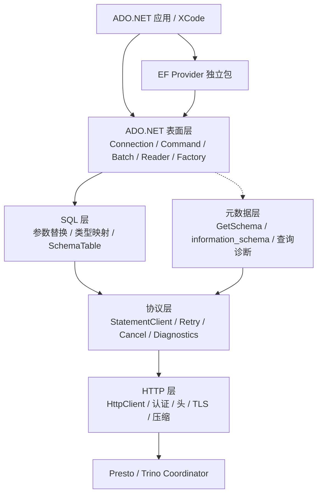

# NewLife.Presto 架构设计

> 版本：v2.1 | 日期：2026-11-21
> 需求：[需求文档](需求文档.md) | 功能清单：[功能清单](功能清单.md) | 竞品：[竞品分析](竞品分析.md)

## 1. 分层

- 表面层只做 ADO.NET 状态与结果适配；协议层可脱离 `DbConnection` 独立测试。
- 零第三方依赖：HTTP 用 BCL，JSON/日志/工具用 `NewLife.Core`。
- 可选能力（结构化复杂类型、OAuth2、DbBatch、EF）不改变默认行为。

## 2. 组件

| 层 | 组件 | 说明 |
|----|------|------|
| 系统 | `PrestoConnectionStringBuilder` / `PrestoConnectionOptions` | 连接串解析、别名、默认值、校验 |
| 系统 | `PrestoConnection` | `DbConnection`；持有 options、会话、共享 HttpClient |
| 系统 | `PrestoHttpClientCache` | 按端点/TLS/代理/压缩/超时缓存 HttpClient |
| 系统 | `PrestoAuthProvider` / `PrestoOAuthTokenProvider` | Basic/JWT/OAuth2 认证头与令牌刷新 |
| 系统 | `PrestoSessionState` / `PrestoHeaders` | 会话头构建与 Set-* 指令应用；双协议头名 |
| 系统 | `PrestoDiagnostics` / `PrestoException` | ActivitySource、脱敏、查询 ID/错误码 |
| 协议 | `PrestoStatementClient` | 提交、轮询、取消 |
| 协议 | `PrestoQueryResults` / `PrestoColumn` / `PrestoQueryError` | 响应模型 |
| 协议 | `PrestoRetryPolicy` | 429/502/503/504、Retry-After、指数退避 + 抖动 |
| 协议 | `PrestoJson` | JsonParser 字典模型 → 强类型响应 |
| SQL | `PrestoCommand` | `DbCommand`；执行、取消、超时 |
| SQL | `PrestoParameterBinder` | `@name` 词法替换与字面量格式化 |
| SQL | `PrestoTypeMapper` / `PrestoTypeSignature` | 类型签名解析与 .NET 映射 |
| SQL | `PrestoComplexValueParser` | 结构化复杂类型取值 |
| SQL | `PrestoDataReader` / `PrestoSchemaTable` | 结果页读取与 SchemaTable |
| SQL | `PrestoBatch`（net6+） | DbBatch 顺序提交与行数汇总 |
| 元数据 | `PrestoMetaData` | GetSchema 集合、information_schema 查询缓存 |
| 元数据 | `PrestoQueryInfo` | 查询列表/详情/节点只读诊断 |
| EF | `PrestoOptionsExtension` / `PrestoSqlGenerator` | 服务注册、SQL 生成、只读拒绝 |

## 3. 连接与传输

| 参数 | 别名/默认 | 说明 |
|------|-----------|------|
| `Host` | Server/Data Source，`localhost` | 协调器主机 |
| `Port` | `8080` | HTTPS 常用 443，需显式指定 |
| `Catalog` / `Schema` | Database / Owner | XCode 的 Database/Owner 映射 |
| `User` | 环境用户 → `anonymous` | 缺省不抛异常 |
| `Auth` | 有密码 Basic，否则 None | `None`/`Basic`/`JWT`/`OAuth2` |
| `Protocol` | `Presto` | `Trino` 或 `TrinoHeaders=true` 切换 |
| `ComplexTypes` | `String` | `Structured` 返回结构化对象 |
| `Compression` | `true` | Accept-Encoding + 自动解压 |
| `Spooling` | `false` | Trino Spooling 协议；仅未压缩 `json`，服务端不支持时回退直接协议 |
| `CommandTimeout` / `ConnectionTimeout` | `0` / `100` | 命令超时秒数 / HTTP 请求超时秒数 |
| `MaxRetries` / `RetryInterval` | `3` / `200` | 重试次数与初始退避毫秒 |

其余参数（TLS、会话、代理、路径、OAuth2、自定义头）见 `PrestoConnectionStringBuilder`；`Pooling` 可解析但不生效，连接复用由 `HttpClientHandler` 负责。

- 共享 HttpClient 缓存键：`scheme + host + port + path + proxy + TrustServerCertificate + Compression + ConnectionTimeout`；认证头按请求附加。
- `net45` 显式启用 TLS 1.2。
- `Open` 默认不探测；`TestConnection=true` 请求 `/v1/info`，失败回到 Closed。
- `Close` 尽力取消活跃查询；连接对象非线程安全，HttpClient 线程安全。

## 4. 协议

- `status` 只用于展示，完成判定以 `nextUri` 缺失且 `error` 为空为准；状态按字符串保存，未知状态只记 Debug。
- 重试：429/502/503/504 按 `Retry-After`（秒/HTTP 日期）或指数退避；**只重试 GET/轮询**，POST 提交不重试。
- 取消：CTS + best-effort DELETE `nextUri`（短超时，失败仅记 Debug）；取消异常不被清理异常覆盖。
- 读取器提前 Close/Dispose 使用**非阻塞** DELETE；显式 `Cancel()` 与 `SchemaOnly` 等待取消完成。
- 压缩默认 gzip/deflate；`Compression=false` 时不发送并适配网关。
- 分页由服务端 `nextUri` 驱动，驱动不拼接 LIMIT/OFFSET。
- Spooling（`Spooling=true`）：提交时发送 `X-Trino-Query-Data-Encoding: json`；响应 `data` 为对象时按 `encoding + segments` 解析，`inline` 分段做 Base64 解码，`spooled` 分段用分段自带请求头直接下载（不带会话/认证头，`Accept-Encoding: identity`），读完后 GET `ackUri` 确认，失败只记 Debug 等待服务端 TTL 清理。只实现未压缩 `json`，其它编码与未知分段类型明确报错；服务端没有 `json` 编码时自动回退直接协议。

## 5. 查询执行

### 5.1 参数

- 仅 `@name`，不区分大小写；重复参数复用同一值；缺失参数抛异常。
- 词法替换跳过单引号字符串、双引号标识符、`--` 行注释、`/* */` 块注释。
- 字面量：NULL / true,false / InvariantCulture 数值 / `'...'`（内部 `'` 转义）/ `TIMESTAMP '...'` / `X'hex'` / `UUID '...'` / 集合括号列表。

### 5.2 类型映射

| Presto | .NET | 备注 |
|--------|------|------|
| boolean | Boolean | |
| tinyint / smallint / integer / bigint | SByte / Int16 / Int32 / Int64 | |
| real / double | Single / Double | |
| decimal(p,s) | Decimal | InvariantCulture |
| varchar / char / json | String | 不做定长补空格 |
| varbinary | Byte[] | Base64 解码 |
| date / timestamp(p) | DateTime | 精度保留到 ticks |
| timestamp with time zone | DateTimeOffset | 保留偏移 |
| time | TimeSpan | |
| time with time zone | String | 避免伪造 DateTimeOffset |
| interval day to second | TimeSpan | |
| interval year to month | String | 月数语义不等同 TimeSpan |
| uuid | Guid | |
| ipaddress | IPAddress | |
| array / map / row | String（默认）/ Object（Structured） | 按类型签名递归转换 |
| 未知类型 | String | `GetDataTypeName` 返回原始类型 |

### 5.3 Reader 与 CommandBehavior

| 行为 | 实现 |
|------|------|
| Default | 读取全部页 |
| SchemaOnly | 取 columns 后停止并取消查询 |
| SingleRow | 读首行后停止并取消 |
| CloseConnection | Reader 关闭时关闭连接 |

- 构造时预取首屏确定 `FieldCount`/`HasRows`；`NextResult()` 恒 false。
- `ExecuteNonQuery`：`updateCount` → 单列 `rows` → 有 updateType 无计数返回 0 → 无法判断返回 -1。
- `DbBatch`：按顺序逐条提交，汇总行数；`ExecuteReader/Scalar` 返回最后一条；不做服务端批量。
- 复杂类型结构化：`array→Object[]`、`map→IDictionary<String,Object?>`、`row→Object[]`；畸形值回退原始字符串。

## 6. 元数据

| 集合 | 来源 | 主要列 |
|------|------|--------|
| MetaDataCollections | 静态 | CollectionName / NumberOfRestrictions / NumberOfIdentifierParts |
| Tables | `information_schema.tables` | TABLE_CATALOG / TABLE_SCHEMA / TABLE_NAME / TABLE_TYPE |
| Columns | `information_schema.columns` | 列名 / 序号 / 类型 / 可空 / 默认值 |
| DataTypes | 静态 | TypeName / ProviderDbType / ColumnSize / CreateFormat |

- `GetSchema()` 无参返回 MetaDataCollections；结果缓存 30 秒，连接或 schema 变化失效。
- Catalog/Schema 发现用 `SHOW CATALOGS`/`SHOW SCHEMAS`，失败回退 information_schema。
- 能力探测只做保守判断：服务端拒绝写/事务/DDL 时原样抛出。
- 查询诊断：`GET /v1/query`、`/v1/query/{id}`、`/v1/node`；只读，兼容 `queryId`/`id`、`queryStats`/`stats`、`errorInfo`/`error` 字段差异。

## 7. 兼容性

| 请求头 | Presto | Trino |
|--------|--------|-------|
| 用户 / Catalog / Schema | `X-Presto-User/Catalog/Schema` | `X-Trino-User/Catalog/Schema` |
| 会话 / 来源 / 时区 / 资源组 | `X-Presto-*` | `X-Trino-*` |

- 响应头按前缀读取 `Set-Catalog`/`Set-Schema`/`Set-Session`/`Clear-Session`/`Set-Role`。
- 未知字段忽略、缺失字段取默认；不自动探测协议。
- 网关：`Path` 前缀、`Proxy`、自签名证书开关；`nextUri` 以响应中的绝对 URI 为准，相对 URI 按基地址解析。

## 8. XCode 集成

| XCode 写法 | 驱动参数 |
|------------|----------|
| Host / Server / Data Source | Host |
| Database | Catalog |
| Owner | Schema |
| TrinoHeaders | Protocol |
| UseSsl | UseSsl |

- 工厂：`NewLife.Presto.PrestoClientFactory`（无参 + `Instance`），可被 `LoadFactory` 反射加载。
- 加载顺序：本驱动优先、失败回退旧驱动；新驱动只做本地加载，不发起网络请求。
- 能力边界：无事务/自增/DDL/批量；`Migration=Off`；`UseParameter` 可开启；分页 SQL 由 XCode 生成。

## 9. EF Provider（独立包）

| 包 | 目标框架 | 依赖 | 入口 |
|---|---|---|---|
| `NewLife.Presto.EntityFrameworkCore` | net6/8/10/11 | EF Core Relational 6.0.36/8.0.28/10.0.9/11.0.0 | `UsePresto` / `AddPresto` |
| `NewLife.Presto.EntityFramework` | net45/net461 | EF 6.5.2 | `PrestoEFConfiguration` |

- EF Core：`PrestoOptionsExtension` 注册连接、命令批工厂、更新/迁移 SQL 生成器、历史仓储、查询 SQL 生成器、类型映射源、方法/成员翻译器；标识符双引号，Schema 点分映射 `catalog.schema`，`OFFSET` 固定在 `LIMIT` 之前。
- EF Core 10+ 不再内置字符串/数学/日期翻译器，Provider 自带 `strpos/substr/upper/lower/length`、`abs/round/power`、`date_add/date_diff`。
- EF6：`PrestoProviderServices` + `PrestoProviderManifest` + `PrestoSqlGenerator`；透明查询（扫描/过滤/排序/投影）向上合并，不透明查询（去重/分组/分页/APPLY/联合）包装子查询，绑定变量经别名表解析。
- 只读：`SaveChanges`、`Create/Delete/CreateTables/Migrate` 一律 `NotSupportedException`；EF6 要求列名与 CLR 属性名一致。
- EF Core 工程在 net8+ 启用 `IsAotCompatible` 分析器（0 告警）；运行时 AOT 能力仍取决于 EF Core 本体与编译模型。

## 10. 关键设计决策

| 决策点 | 方案 | 备选 | 理由 |
|--------|------|------|------|
| 包划分 | 单包同时支持 PrestoDB/Trino | 拆 `NewLife.Trino` | 协议相同，仅头前缀差异；拆包双份维护 |
| 协议 | HTTP REST v1 | Thrift | 官方协议，两边通用，零依赖 |
| JSON | NewLife.Core JsonParser | System.Text.Json | 覆盖 net45 且零第三方依赖 |
| 参数化 | 客户端 `@name` 替换 | 服务端预编译 | REST 无通用绑定参数；与 XCode 兼容 |
| 连接池 | 共享 HttpClient | 自建池 | 连接复用由 handler 负责 |
| Open 探测 | 默认不探测 | 每次 `/v1/info` | 避免高频 Open 放大延迟 |
| ExecuteNonQuery | updateCount → rows → -1 | 固定 1 | 不伪造行数 |
| 状态字段 | String | Enum | 服务端会新增状态 |
| 取消 | CTS + best-effort DELETE | 仅 CTS | 释放服务端资源；失败不影响原始异常 |
| 提前取消 | 非阻塞 DELETE | 同步等待 | 短查询少一次往返 |
| EF 支持 | 独立包 | 核心包内置 | 核心零依赖；EF 版本差异大 |
| EF 只读 | 写入/迁移拒绝 | 生成 DDL | 写入语义由连接器决定，显式拒绝更安全 |
| 双协议头 | 显式配置 | 自动探测 | 无额外请求 |
| 元数据 | information_schema + GetSchema | 私有接口 | 标准、跨版本 |
| AOT | 无反射 + 条件编译 | 反射 | net8+ 裁剪要求 |
| OAuth2 | 仅客户端凭据 | 交互式 | 可无人值守；交互式依赖 IdP |
| Spooling 编码 | 仅未压缩 `json` | `json+lz4`/`json+zstd` | 零第三方依赖无法解码；服务端不支持时自动回退，不影响既有集群 |
| Spooling 分段 | 整页解析后追加行 | 逐段惰性流式 | 与现有按页消费模型一致；单页内存可控 |
| 复杂类型 | 默认字符串，可选结构化 | 一律结构化 | 兼容既有行为 |
| DbBatch | 顺序提交汇总 | 拼多语句 | REST 无批量语义 |

## 11. 测试与交付

| 项 | 内容 |
|----|------|
| 离线单测 | 连接串、参数、类型、错误、JSON、重试、状态机、认证、DbBatch、复杂类型、诊断接口、Spooling 分段 |
| 假 HTTP | 按队列返回响应，断言请求方法/URI/头、POST 一次、GET 跟随、503 重试、取消 DELETE、gzip 解压 |
| 真库集成 | `PRESTO_TEST_CONNSTR`/`TRINO_TEST_CONNSTR` 启用，未配置跳过；Trino 476 与 PrestoDB 0.300 实测 |
| EF 测试 | EF Core net8/net10；EF6 net472 仅 Windows（`appDomain: denied`） |
| CI | win-x64/linux-x64/linux-arm64 构建 + 单测；win-x64 覆盖率门禁行 100%、分支 ≥95% |
| 打包 | 三包同版本：核心（net45~net11）、EF Core（net6/8/10/11）、EF6（net45/net461）；snupkg + SourceLink |
| AOT | net8+ `IsAotCompatible`，零 IL 告警；AotSmoke 覆盖 win-x64/linux-x64/linux-arm64 |

## 12. 风险

| 风险 | 缓解 |
|------|------|
| 连接器写/事务能力差异 | 不承诺写能力，服务端错误原样抛出 |
| 大页 JSON 内存 | 按页消费；评估流式解析 |
| 时区/精度差异 | 按类型签名解析，DateTimeOffset 保留偏移 |
| 网关改写响应头/nextUri | 以响应为准，缺失保留本地状态并告警 |
| net45 TLS 默认旧 | 显式启用 TLS 1.2 |
| 服务端新增状态/字段 | 字符串化 + 宽松解析 |
| Spooling 分段不可读/确认失败 | 下载失败映射为驱动异常；确认失败仅记日志，服务端 TTL 兜底 |
| 无事务/DDL | 明确能力边界，异常提示业务主键方案 |